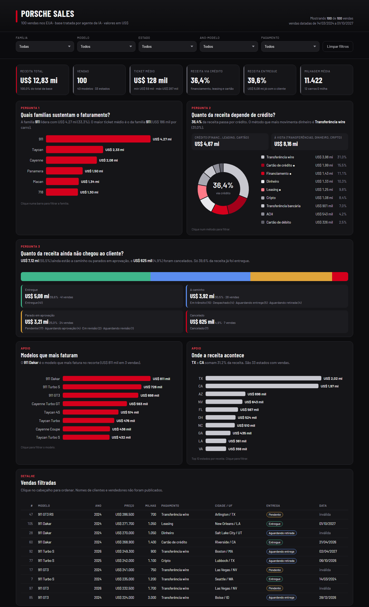
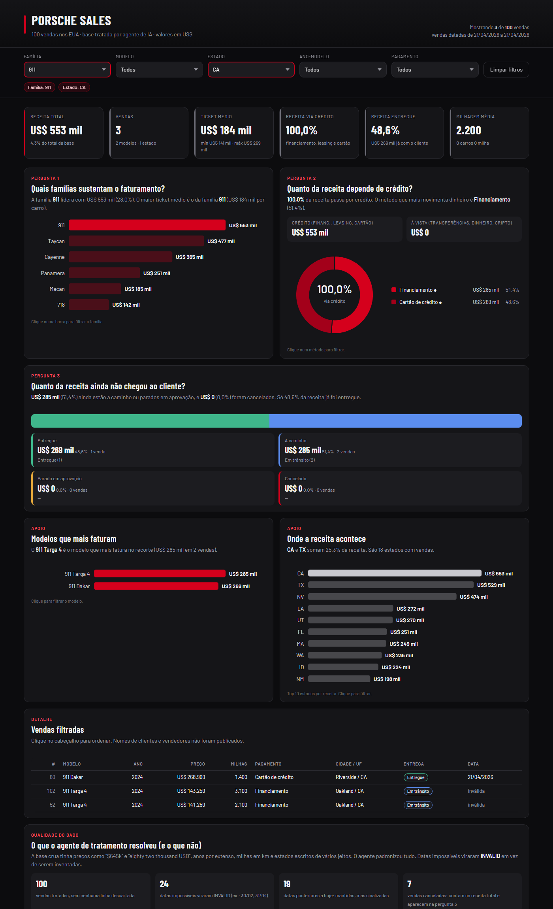
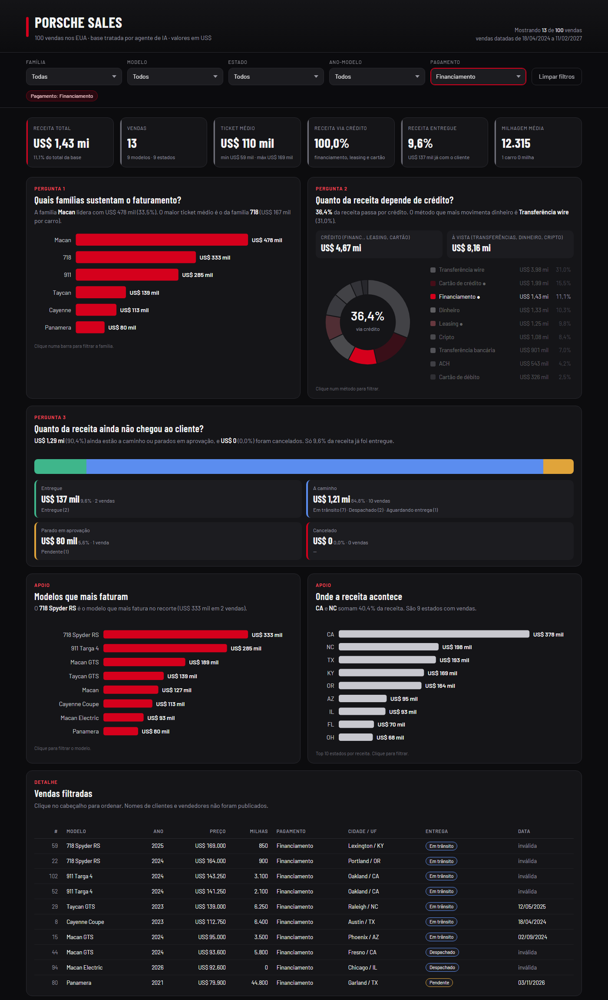

# Porsche Sales: dashboard com agentes de IA

Dashboard interativa em **HTML de arquivo único**, publicada no GitHub Pages, que responde três perguntas de negócio sobre **100 vendas Porsche nos EUA**. Ela parte da base **crua** e passa por um agente de tratamento de dados antes de chegar à IA que desenha a dashboard.

🔗 **Dashboard publicada:** https://brenolrocha22.github.io/porsche-sales-dashboard/

Projeto do Desafio de Projeto **"Criando uma Dashboard da Porsche com Agentes de IA"** da DIO, na trilha *Reclame Aqui – Dados e IA na Prática*.



## As três perguntas de negócio

| # | Pergunta | Por que escolhi | Como a dashboard responde |
|---|---|---|---|
| 1 | **Quais famílias de modelo sustentam o faturamento?** | Mostra onde concentrar estoque e esforço comercial | Barras de receita por família (911, Taycan, Cayenne, Panamera, Macan, 718) e frase com a líder e o maior ticket |
| 2 | **Quanto da receita depende de crédito?** | Mede a exposição a juros e aprovação de crédito: se as taxas sobem, essa fatia é a que sofre | Rosca por método de pagamento, com o % via financiamento, leasing e cartão no centro, e comparação crédito x à vista |
| 3 | **Quanto da receita ainda não chegou ao cliente?** | Venda registrada não é dinheiro garantido: carro parado em aprovação ou cancelado é risco | Barra 100% e cartões com Entregue, A caminho, Parado em aprovação e Cancelado |

**Respostas na visão geral:**
1. A família **911** lidera com **US$ 4,27 mi (33,3%)** e tem o maior ticket médio (US$ 186 mil).
2. **36,4%** da receita passa por crédito. O método que mais movimenta dinheiro é a **transferência wire (31,0%)**.
3. Só **39,6%** da receita já foi entregue. **55,5%** está a caminho ou parada em aprovação, e **4,9%** foi cancelada.

Também há dois painéis de apoio (modelos que mais faturam e top 10 estados), a tabela de vendas filtradas e um painel de qualidade do dado.

## Filtros e indicadores

- **Indicadores de topo:** receita total, vendas, ticket médio, % via crédito, % entregue e milhagem média.
- **Filtros:** família, modelo (dependente da família), estado, ano-modelo e método de pagamento.
- **Clique nos gráficos para filtrar.** Também dá para abrir um recorte pela URL, por exemplo `?familia=911&estado=CA`.

**Exemplo de filtro aplicado:** família 911 em CA dá 3 vendas, US$ 553 mil, e 100% delas pagas com crédito.



**Filtro por pagamento = Financiamento:**



## Tratamento da base antes da IA

```
data/porsche_raw.xlsx                 base crua (100 vendas, 12 colunas)
        │  agents/sanitize_porsche.py    ← agente de tratamento (regras em agents/schema.md)
        ▼
data/porsche_sanitized.xlsx           cada coluna + sua versão *Sanitized ao lado
        │  agents/prepare_base.py        ← só colunas sanitizadas, números de verdade, família
        ▼
data/porsche_dashboard_base.xlsx/.json   base que vai para a dashboard (só valores)
        │  agents/build_html.py          ← embute o JSON no template
        ▼
index.html                            dashboard publicada
```

**O que a base crua tinha e o agente resolveu:**

| Campo | Exemplos crus | Tratado |
|---|---|---|
| Data | `2024-02-30`, `03/14/2024`, `April 31st, 2024` | `YYYY-MM-DD` ou `INVALID` |
| Preço | `$79,500.00`, `USD 112.750`, `68.900 dollars`, `eighty two thousand USD` | `79500.00`, `112750.00`… |
| Ano | `twenty twenty four`, `20-23` | `2024`, `2023` |
| Milhas | `9,800 miles`, `1.200 mi`, `KM 15.200`, `new` | milhas inteiras (km × 0,621371) |
| Pagamento | `Credit card`, `Financing plan`, `bank-transfer` | 9 rótulos controlados |
| Estado | `ma`, `Washington`, `colorado` | sigla USPS (`MA`, `WA`, `CO`) |
| Entrega | `DELIVERED`, `in Transit`, `deliverd` | 10 rótulos controlados |

**Preparação para a dashboard** (`prepare_base.py`):
- Fiquei **só com as colunas sanitizadas**, mais o ID.
- **Preço, ano e milhas viraram número**, e `INVALID` virou vazio. A base sai **só com valores**, sem fórmula.
- Criei a coluna **família** a partir do modelo.
- **Removi nome de cliente e de vendedor**, porque a base vai embutida e pública no HTML.

**Resultado:** nenhuma linha descartada. Só **24 datas** ficaram `INVALID`, todas datas impossíveis como 30/02 e 31/04; elas continuam valendo para receita e entregas e somem apenas do período. O painel de qualidade também sinaliza datas posteriores a hoje.

## Prompt e ferramenta

Usei o caminho do **agente com skill**: o Claude Code trabalhando como agente, com uma skill que trata o dado e outra que desenha a dashboard. É a ideia de evolução "agente com duas skills" do desafio. Não usei o ChatGPT com Canvas.

O prompt completo e a lista do que mudou até a versão final estão em [`prompts/prompt-dashboard.md`](prompts/prompt-dashboard.md). Os principais ajustes foram:
- trocar o filtro de cidade por estado (79 cidades em 100 vendas);
- fazer cada gráfico ignorar o próprio filtro, para manter a comparação;
- tirar os nomes de pessoas da base;
- agrupar os 10 status de entrega em 4 situações;
- corrigir textos achados no teste.

## Visual

- Fundo grafite com **vermelho como única cor de destaque**, prata e cinzas para o restante, e verde, azul e âmbar só nos status de entrega.
- Tipografia **Barlow Condensed** nos títulos e **Barlow** no texto.
- Gráficos desenhados em SVG à mão, sem biblioteca, e layout responsivo para celular.

## Como reproduzir

```bash
pip install openpyxl
python agents/sanitize_porsche.py data/porsche_raw.xlsx data/porsche_sanitized.xlsx
python agents/prepare_base.py data/porsche_sanitized.xlsx data/porsche_dashboard_base.xlsx data/porsche_dashboard_base.json
python agents/build_html.py src/dashboard.template.html data/porsche_dashboard_base.json index.html
```

Abra o `index.html` no navegador. Para publicar, suba o repositório e ative o **GitHub Pages** (Settings → Pages → branch `main`, pasta raiz).

## Estrutura

```
index.html                     dashboard publicada (arquivo único, base embutida)
src/dashboard.template.html    template da dashboard, sem os dados
agents/sanitize_porsche.py     agente de tratamento
agents/schema.md               regras de tratamento
agents/prepare_base.py         prepara a base da dashboard
agents/build_html.py           embute a base no HTML
data/                          base crua, tratada e base final (.xlsx e .json)
prompts/prompt-dashboard.md    prompt e histórico de mudanças
images/                        prints da dashboard
```

## Observações

- **Dados fictícios** de laboratório da DIO.
- As regras do `schema.md` vêm do material do lab. Encontrei o arquivo publicado no repositório de outro aluno ([robsondpreuss/Acelera-o-AI-Reports-com-Excel](https://github.com/robsondpreuss/Acelera-o-AI-Reports-com-Excel)).
